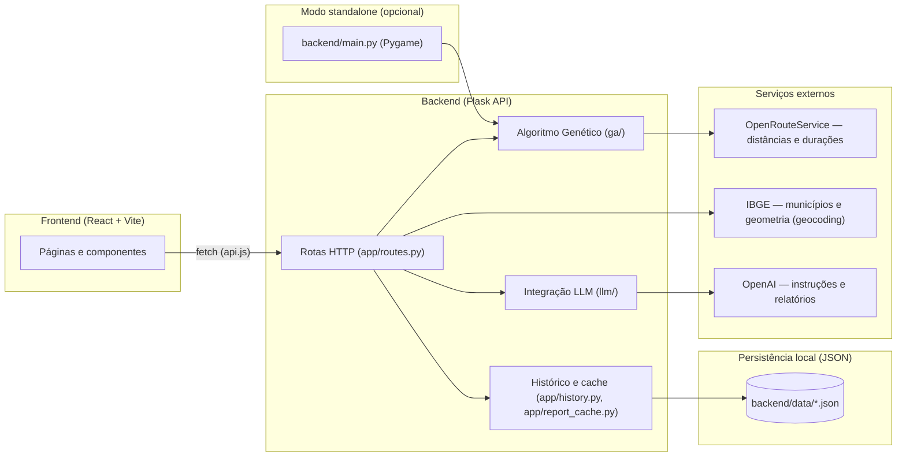
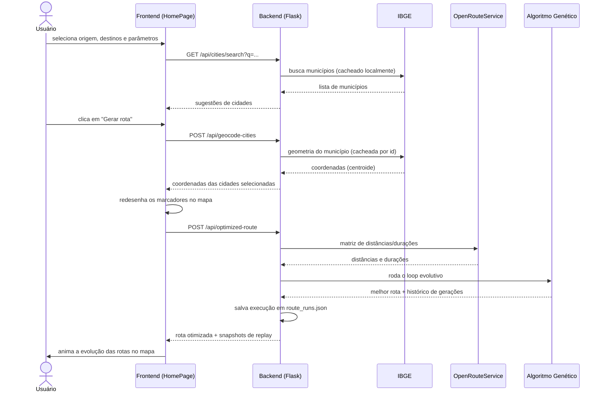

# Arquitetura

Documentação técnica detalhada do projeto. Para visão geral e instruções de uso, veja o [README](../README.md).

## Visão geral

A aplicação é dividida em duas partes que se comunicam por HTTP: um **frontend React** (interface do usuário) e um **backend Flask** (algoritmo genético + integrações externas). Além disso, existe um **modo standalone** (`backend/main.py`) que roda o algoritmo isoladamente com Pygame, sem depender do frontend nem do servidor web.



**Por que não há banco de dados?** O projeto é um protótipo acadêmico; o histórico de execuções e os caches de relatórios da LLM são persistidos como arquivos JSON em `backend/data/`, evitando a complexidade de configurar e versionar um banco de dados para um volume de dados pequeno.

## Estrutura de pastas

```
backend/
├── run.py                 # ponto de entrada do servidor Flask
├── main.py                # demonstração standalone via Pygame
├── app/                   # camada HTTP (rotas, orquestração, persistência)
│   ├── routes.py
│   ├── services.py        # loop do algoritmo genético (versão headless/API)
│   ├── history.py         # persistência do histórico de execuções
│   └── report_cache.py    # cache dos relatórios gerados por LLM
├── ga/                     # algoritmo genético puro (sem Flask, sem LLM)
│   ├── calculation.py      # distâncias, fitness, duração
│   ├── selection.py        # seleção por torneio, validação de prazo
│   ├── crossover.py        # order crossover (OX)
│   ├── mutation.py         # mutação por segmento
│   └── initial_population.py
├── llm/                     # geração de texto via LLM (OpenAI)
│   ├── llm_client.py
│   ├── route_instructions.py      # instruções para o motorista
│   ├── route_reports.py           # relatório comparativo por grupo de cidades
│   └── process_recommendations.py # recomendações de processo (histórico completo)
├── services/                 # clientes de API externas
│   ├── api_requests.py       # OpenRouteService (distâncias/durações)
│   └── ibge_cities.py        # IBGE (lista de municípios + geocodificação)
├── data/
│   ├── route_cities.py       # dataset fixo das 16 cidades
│   └── *.json                # arquivos gerados em runtime (histórico, caches)
├── config/
│   ├── constants.py
│   ├── interfaces.py          # tipos (CityEntity, Matrix, OptimizeRoutePayload...)
│   └── helpers.py
├── viz/
│   └── draw_functions.py      # desenho Pygame/Matplotlib (só usado por main.py)
└── tests/                     # testes automatizados (pytest)

frontend/src/
├── App.jsx                    # roteamento (react-router-dom)
├── api.js                     # todas as chamadas HTTP ao backend
├── pages/
│   ├── HomePage.jsx            # planejamento e geração de rota
│   ├── ReportsPage.jsx         # relatórios comparativos por grupo de cidades
│   └── RecommendationsPage.jsx # recomendações de processo (histórico completo)
└── components/                 # formulário, mapa, modais, etc.
```

## Fluxo de dados: gerar uma rota



## Integração com LLM

Três funcionalidades usam a API da OpenAI (via `backend/llm/llm_client.py`), cada uma com um *system prompt* específico, sempre enfatizando que a LLM não deve inventar ou recalcular números — apenas interpretar os dados fornecidos pelo backend:

| Funcionalidade | Endpoint | Entrada enviada à LLM | Onde aparece no frontend |
|---|---|---|---|
| Instruções para o motorista | `POST /api/driver-instructions` | distância/duração de cada trecho da rota | Modal na aba Início (botão "Gerar instruções") |
| Relatório comparativo | `POST /api/route-runs/comparative-report` | execuções anteriores do **mesmo** conjunto de cidades | Aba Relatórios (accordion por grupo) |
| Recomendações de processo | `POST /api/process-recommendations` | **todas** as execuções do histórico | Aba Recomendações |

Os relatórios comparativos e as recomendações de processo são **cacheados** em `backend/data/comparative_reports.json`, usando como chave o conjunto exato de execuções que gerou aquele relatório — se nenhuma execução nova for adicionada, a resposta salva é reutilizada em vez de chamar a LLM de novo.

## Persistência local (`backend/data/*.json`)

| Arquivo | Conteúdo | Quando é escrito |
|---|---|---|
| `route_runs.json` | Histórico de execuções do algoritmo (parâmetros, resultado, rota) | A cada chamada bem-sucedida a `/api/optimized-route` |
| `comparative_reports.json` | Cache dos relatórios/recomendações gerados por LLM | A cada relatório novo gerado |
| `sp_municipalities.json` | Lista dos 645 municípios de SP (nome + id, via IBGE) | Uma vez, na primeira busca de cidade |
| `sp_municipality_coordinates.json` | Coordenadas (centroide) já calculadas por município | Sob demanda, quando uma cidade é geocodificada pela primeira vez |

Esses arquivos são gerados em runtime e não são versionados no repositório (ver `.gitignore`).

## Referência de API

| Método | Rota | Descrição |
|---|---|---|
| `GET` | `/api/cities` | Lista o dataset fixo de 16 cidades |
| `GET` | `/api/cities/search?q=` | Busca por nome entre os 645 municípios de SP (mín. 2 caracteres) |
| `POST` | `/api/geocode-cities` | Resolve nomes de cidades em coordenadas `[lon, lat]` |
| `POST` | `/api/optimized-route` | Roda o algoritmo genético e retorna a rota otimizada |
| `GET` | `/api/route-runs` | Histórico completo de execuções |
| `POST` | `/api/route-runs/comparative-report` | Relatório comparativo (LLM) para um conjunto de cidades |
| `POST` | `/api/process-recommendations` | Recomendações de processo (LLM) sobre todo o histórico |
| `POST` | `/api/driver-instructions` | Instruções em linguagem natural (LLM) para uma rota |

## O que o modo standalone (`backend/main.py`) faz diferente

`main.py` roda o mesmo algoritmo genético, mas de forma independente da API: usa sempre o conjunto fixo de 16 cidades, parâmetros fixos (`config/constants.py`), e renderiza cada geração em tempo real numa janela Pygame (em vez de retornar JSON pro frontend). Não salva histórico, não chama a LLM via HTTP (imprime as instruções no console ao final) e não depende do servidor Flask estar rodando. É útil para demonstrar o algoritmo isoladamente, sem precisar subir o frontend.
