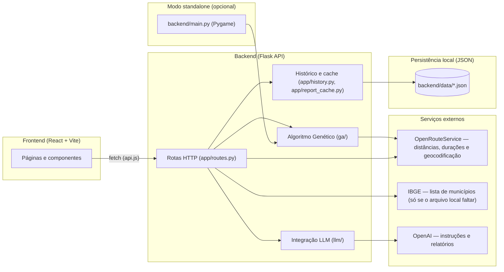
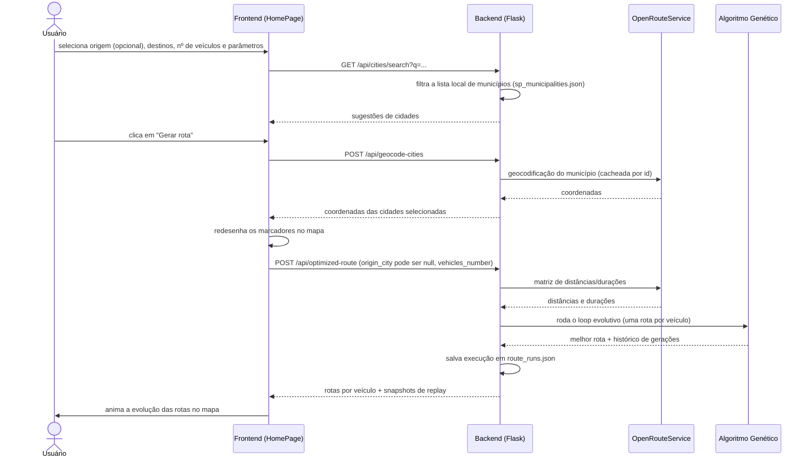
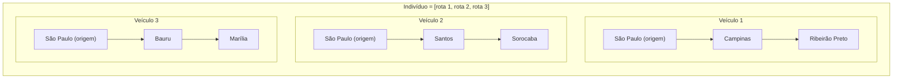
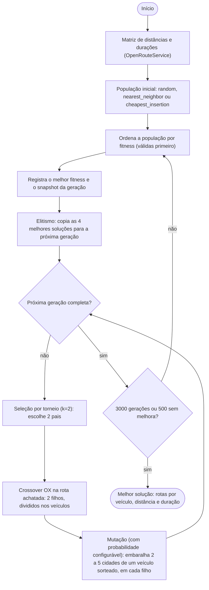

# Arquitetura

Documentação técnica detalhada do projeto. Para visão geral e instruções de uso, veja o [README](../README.md).

## Visão geral

A aplicação é dividida em duas partes que se comunicam por HTTP: um **frontend React** (interface do usuário) e um **backend Flask** (algoritmo genético + integrações externas). Além disso, existe um **modo standalone** (`backend/main.py`) que roda o algoritmo isoladamente com Pygame, sem depender do frontend nem do servidor web.



**Por que não há banco de dados?** O projeto é um protótipo acadêmico; o histórico de execuções e os caches de relatórios da LLM são persistidos como arquivos JSON em `backend/data/`, evitando a complexidade de configurar e versionar um banco de dados para um volume de dados pequeno.

## Estrutura de pastas

```
backend/
├── run.py                 # ponto de entrada do servidor Flask
├── main.py                # demonstração standalone via Pygame
├── demo.py                # demonstração sem interface (python -m backend.demo)
├── baselines.py           # outras abordagens (guloso, busca aleatória, força bruta) para o comparativo
├── benchmark.py           # compara o AG com as demais abordagens (python -m backend.benchmark)
├── app/                   # camada HTTP (rotas, orquestração, persistência)
│   ├── routes.py
│   ├── services.py        # loop do algoritmo genético (versão headless/API)
│   ├── history.py         # persistência do histórico de execuções
│   └── report_cache.py    # cache dos relatórios gerados por LLM
├── ga/                     # algoritmo genético puro (sem Flask, sem LLM)
│   ├── calculation.py      # distâncias, fitness, duração
│   ├── selection.py        # seleção por torneio, validação de prazo
│   ├── crossover.py        # order crossover (OX) sobre a rota achatada
│   ├── mutation.py         # mutação por segmento em um veículo sorteado
│   └── initial_population.py
├── llm/                     # geração de texto via LLM (OpenAI)
│   ├── llm_client.py
│   ├── route_instructions.py      # instruções para o motorista
│   ├── route_reports.py           # relatório comparativo por grupo de cidades
│   └── process_recommendations.py # recomendações de processo (histórico completo)
├── services/                 # clientes de API externas
│   ├── api_requests.py       # OpenRouteService (distâncias/durações)
│   └── ibge_cities.py        # lista de municípios (IBGE) + geocodificação (OpenRouteService)
├── data/
│   ├── route_cities.py       # dataset fixo das 16 cidades (demo Pygame e pré-preenchimento do formulário)
│   └── *.json                # arquivos gerados em runtime (histórico, caches)
├── constants/
│   ├── ga.py              # parâmetros do GA (VEHICLES_NUMBER, TIME_LIMIT, PopulationType...)
│   └── pygame.py          # constantes da demo Pygame
├── models/
│   ├── common/            # tipos compartilhados (CityEntity, Individual, Matrix...)
│   └── domain/            # args/payloads por módulo (app, GA, população inicial)
├── helpers/
│   ├── common/            # utilitários gerais (ex.: normalize_text, convert_seconds)
│   └── domain/            # helpers do GA
├── viz/
│   └── draw_functions.py      # desenho Pygame/Matplotlib (só usado por main.py)
└── tests/                     # testes automatizados (pytest): app/, ga/, helpers/, llm/, services/

frontend/src/
├── App.jsx                    # roteamento (react-router-dom)
├── api.js                     # todas as chamadas HTTP ao backend
├── routes.js                  # paleta por veículo, normalizeRoutes, getCitySet
├── routeParams.js             # applyOriginCity (origem x destinos)
├── instructions.js            # splitDriverInstructions (separa pelos marcadores [N])
├── pages/
│   ├── HomePage.jsx            # planejamento e geração de rota
│   ├── ReportsPage.jsx         # relatórios comparativos por grupo de cidades
│   └── RecommendationsPage.jsx # recomendações de processo (histórico completo)
└── components/                 # formulário, mapa, modais, etc.
```

## Fluxo de dados: gerar uma rota



## Algoritmo genético

### Representação de um indivíduo

Um indivíduo é uma lista de rotas, uma por veículo. Cada rota é uma lista ordenada de cidades, e a ordem é a sequência de visita. As rotas são **abertas** (o veículo não volta ao ponto de partida). Quando há origem fixa (cidade `id == 0`), ela é a primeira cidade de todas as rotas; as demais cidades aparecem em exatamente um veículo.

Exemplo com origem fixa em São Paulo, 3 veículos e 7 cidades a visitar:



Sem origem fixa, cada veículo começa na sua primeira cidade e nenhuma cidade se repete entre as rotas. A **fitness** do indivíduo é a soma das distâncias das rotas de todos os veículos; ele só é **válido** se todas as cidades prioritárias de todos os veículos forem atendidas dentro do prazo (`TIME_LIMIT`, 17h).

### Ciclo evolutivo

O loop está em `backend/app/services.py` (versão da API) e em `backend/main.py` (versão Pygame).



Critério de comparação usado na seleção e na ordenação:

| Situação | Vence |
|---|---|
| Ambas válidas | a de menor distância total |
| Uma válida e outra inválida | a válida |
| Ambas inválidas | a com menos prioridades fora do prazo, depois a de menor atraso total, depois a de menor distância |

## Integração com LLM

Três funcionalidades usam a API da OpenAI (via `backend/llm/llm_client.py`), cada uma com um *system prompt* específico, sempre enfatizando que a LLM não deve inventar ou recalcular números — apenas interpretar os dados fornecidos pelo backend:

| Funcionalidade | Endpoint | Entrada enviada à LLM | Onde aparece no frontend |
|---|---|---|---|
| Instruções para o motorista | `POST /api/driver-instructions` | distância/duração de cada trecho, uma sublista por veículo; a LLM inicia o texto de cada veículo com `[N]` e informa a duração total somando os trechos | Modal na aba Início (botão "Gerar instruções"); com 2+ veículos, abas "Motorista N" |
| Relatório comparativo | `POST /api/route-runs/comparative-report` | execuções do **mesmo** conjunto de cidades e **mesmo número de veículos**, no período escolhido (24h, 7 dias ou todo o histórico), junto com métricas já calculadas pelo backend (`llm/report_metrics.py`: melhor/pior/média e economia de distância e tempo) | Aba Relatórios (seletor de período + accordion por grupo) |
| Recomendações de processo | `POST /api/process-recommendations` | **todas** as execuções do histórico | Aba Recomendações |

Os relatórios comparativos e as recomendações de processo são **cacheados** em `backend/data/comparative_reports.json`, usando como chave o período e o conjunto exato de execuções que geraram aquele relatório — se nenhuma execução nova for adicionada, a resposta salva é reutilizada em vez de chamar a LLM de novo.

## Persistência local (`backend/data/*.json`)

| Arquivo | Conteúdo | Quando é escrito |
|---|---|---|
| `route_runs.json` | Histórico de execuções do algoritmo (parâmetros, resultado, `vehicles_number`, `best_route` por veículo, `stops_count` e `city_set` sem repetições) | A cada chamada bem-sucedida a `/api/optimized-route` |
| `comparative_reports.json` | Cache dos relatórios/recomendações gerados por LLM | A cada relatório novo gerado |
| `sp_municipalities.json` | Lista dos 645 municípios de SP (nome + id, via IBGE). **É versionada** no repositório; o IBGE só é consultado se o arquivo faltar | Só se o arquivo não existir |
| `sp_municipality_coordinates.json` | Coordenadas já obtidas na geocodificação da OpenRouteService, por município | Sob demanda, quando uma cidade é geocodificada pela primeira vez |

Exceto `sp_municipalities.json`, esses arquivos são gerados em runtime e não são versionados no repositório (ver `.gitignore`). O IBGE não é alcançável a partir do Render, por isso a lista de municípios vai no repositório e as coordenadas vêm da OpenRouteService.

## Referência de API

Resumo dos endpoints. A documentação completa (corpos, respostas, erros e exemplos `curl`) está em **[API.md](API.md)**.

| Método | Rota | Descrição |
|---|---|---|
| `GET` | `/api/cities` | Lista o dataset fixo de 16 cidades (pré-preenchimento do formulário) |
| `GET` | `/api/cities/search?q=` | Busca por nome entre os 645 municípios de SP (mín. 2 caracteres; ignora acentos e maiúsculas) |
| `POST` | `/api/geocode-cities` | Resolve nomes de cidades em coordenadas `[lon, lat]` |
| `POST` | `/api/optimized-route` | Roda o algoritmo genético e retorna as rotas otimizadas (ver abaixo) |
| `GET` | `/api/route-runs` | Histórico completo de execuções |
| `POST` | `/api/route-runs/comparative-report` | Relatório comparativo (LLM). Corpo: `city_set`, `vehicles_number`, `period` (`day`, `week` ou `all`) |
| `POST` | `/api/process-recommendations` | Recomendações de processo (LLM) sobre todo o histórico |
| `POST` | `/api/driver-instructions` | Instruções em linguagem natural (LLM) para as rotas de cada veículo |

### Contratos principais

`POST /api/optimized-route` — corpo (todos obrigatórios; `origin_city` pode ser `null`):

```json
{
  "origin_city": {"id": 0, "name": "São Paulo", "...": "..."},
  "destination_cities": [{"id": 1, "name": "Campinas", "...": "..."}],
  "population_type": "nearest_neighbor",
  "population_size": 1000,
  "mutation_probability": 0.5,
  "vehicles_number": 3
}
```

Resposta: inclui `cities` (as cidades da execução), `vehicles_number`, `best_route` (lista de listas de nomes, uma por veículo), `stops_count` (cidades distintas atendidas) e os snapshots de replay (`route`/`second_best_route` também por veículo). Erros de validação retornam 400 (ex.: mais veículos que cidades a visitar).

`POST /api/driver-instructions` — corpo `{"route": [["A","B"],["C","D"]], "cities": [...]}`. As coordenadas vêm das `cities` enviadas (não de um dataset fixo); lista plana em `route` é aceita como um único veículo. 400 se faltar `route`/`cities` ou se alguma cidade da rota não estiver em `cities`; 500 se a geração falhar.

## O que o modo standalone (`backend/main.py`) faz diferente

`main.py` roda o mesmo algoritmo genético, mas de forma independente da API: usa sempre o conjunto fixo de 16 cidades, 3 veículos e parâmetros fixos (`backend/constants/`), e renderiza cada geração em tempo real numa janela Pygame (em vez de retornar JSON pro frontend). Não salva histórico, não chama a LLM (ao final imprime no console só as rotas, a distância e o prazo das prioridades, sem gastar créditos da OpenAI) e não depende do servidor Flask estar rodando. É útil para demonstrar o algoritmo isoladamente, sem precisar subir o frontend.

Há ainda uma demonstração **sem interface gráfica** (a pasta `notebooks/` guarda o notebook): `python -m backend.demo` (script) e `notebooks/demo.ipynb` (gráficos de convergência, rotas no mapa, comparação de estratégias e de número de veículos). Ambos usam a matriz de distâncias guardada em `backend/data/demo_routes.json`, então rodam offline, sem OpenRouteService nem OpenAI, e com semente fixa.
